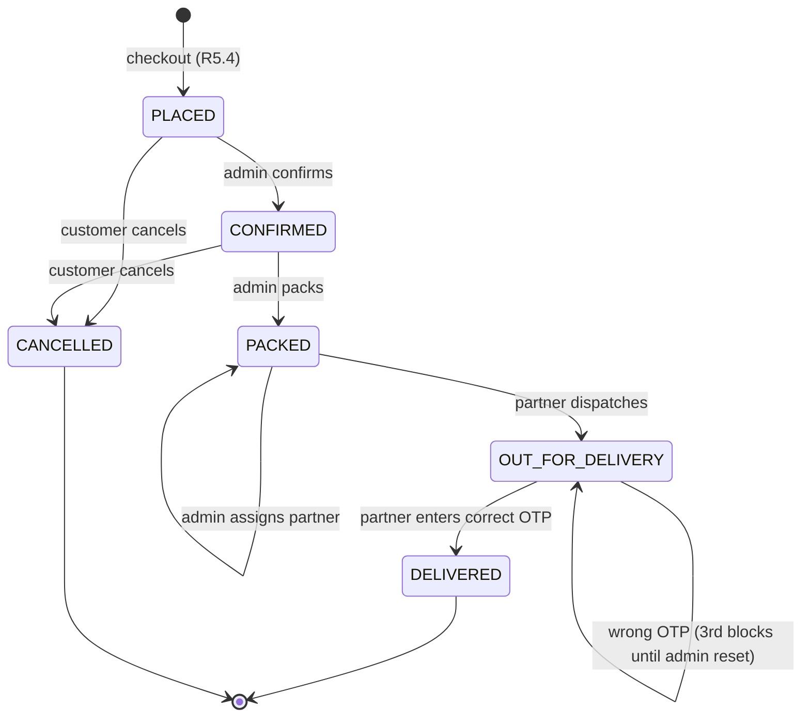
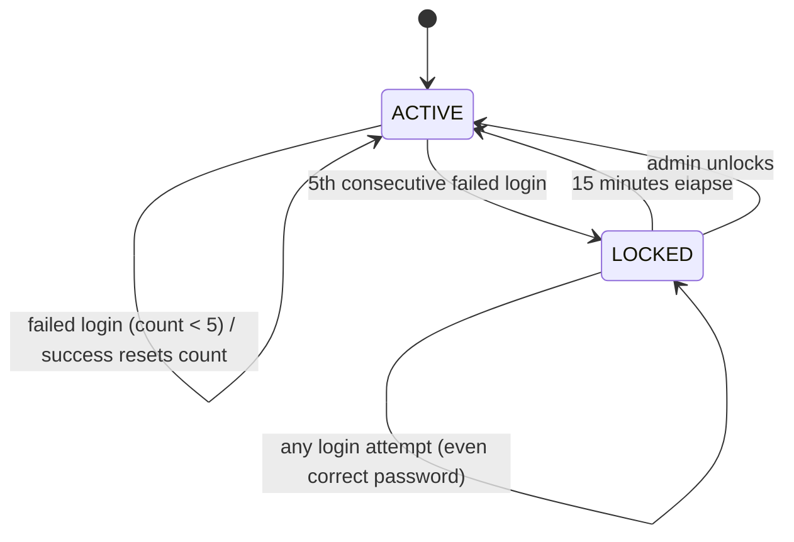

# State Transition Testing

## 1. Order lifecycle (R6.1-R6.4)

### Valid transitions (each must succeed)

| From | Event | To | TC |
|---|---|---|---|
| PLACED | admin confirm | CONFIRMED | TC-M6-005 |
| CONFIRMED | admin pack | PACKED | TC-M6-005 |
| PACKED | admin assigns partner | PACKED (partner set) | TC-M6-008 (precondition), TC-M6-007 |
| PACKED | partner dispatch | OUT_FOR_DELIVERY | TC-M6-008 |
| OUT_FOR_DELIVERY | correct OTP | DELIVERED | TC-M6-008, TC-M6-010 |
| PLACED | customer cancel | CANCELLED | TC-M6-003 |
| CONFIRMED | customer cancel | CANCELLED | TC-M6-014 |

### Invalid transitions (each must be rejected, no state change)

| From | Event | Expected | TC |
|---|---|---|---|
| PLACED | admin set PACKED (skip) | 409 | TC-M6-001 |
| CONFIRMED | admin set PLACED (backward) | 409 | TC-M6-017 |
| CONFIRMED | admin assigns partner before PACKED | 409 | TC-M6-006 |
| PACKED | customer cancel | 409 | TC-M6-004 |
| OUT_FOR_DELIVERY | customer cancel | 409 | TC-M6-016 |
| OUT_FOR_DELIVERY | 3 wrong OTPs, then correct OTP | blocked until admin reset | TC-M6-009 |
| DELIVERED | any admin status change | 409 | TC-M6-002 |
| CANCELLED | admin set CONFIRMED | 409 | TC-M6-015 |

Transition coverage: 7 of 7 valid, 8 of 8 listed invalid. Each valid transition also writes an
audit row (TC-M6-011) and pushes a WebSocket message (TC-M6-013).

## 2. Account lockout (R1.5)

| From | Event | To | TC |
|---|---|---|---|
| ACTIVE | 4 failures then success | ACTIVE, counter reset | TC-M1-026, TC-M1-015 |
| ACTIVE | 5th consecutive failure | LOCKED | TC-M1-014 |
| LOCKED | login with correct password | LOCKED (rejected, clear message) | TC-M1-014 |
| LOCKED | 15 min elapse | ACTIVE | TC-M1-020 |
| LOCKED | admin unlock | ACTIVE | TC-M8-007 |
