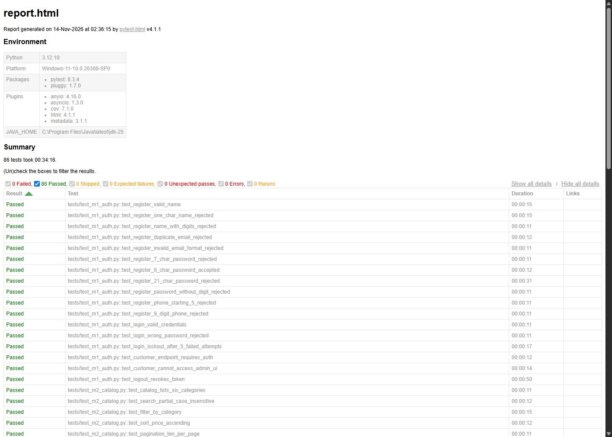

**Defect ID:** DEF-008
**Title:** Any failure of `GET /auth/me` (including an aborted request) logs the user out
**Reported by:** QA (Selenium re-run; root cause of the intermittent login-dependent timeouts)
**Date found:** 2026-11-14
**Found via:** `test_add_product_to_wishlist` failed deterministically after a wait on the logged-in navbar was
added; a script showed `fc_token` missing from `localStorage` right after navigation.
**Module:** M1 Auth (frontend `lib/auth.tsx`)
**Rule ID(s) affected:** R1.5 (30-minute session), R1.6
**Severity:** Medium (a network blip or fast navigation ends the session)
**Priority:** P2
**Environment:** Next.js production build, headless Chrome 157

## Summary

`AuthProvider.loadUser()` calls `GET /auth/me` when the app mounts. Its `catch` block calls `clearToken()` for any
error, not just a 401. If the page is navigated away (or the network drops, or the server answers 5xx) while the
request is in flight, the `fetch` rejects, the token is removed from `localStorage`, and the next page starts logged
out. Protected pages then redirect to `/login`.

## Steps to reproduce

1. Log in (token in `localStorage`).
2. Load `/`, and navigate to another route immediately, before `/auth/me` returns.
3. Read `localStorage.fc_token`.

Script: `python diagnostics/diag_token_cleared_on_navigation.py 12` (login via API, inject token, load `/`, then load
`/` again at once).

## Expected result

The token is kept; only a 401 from `/auth/me` ends the session.

## Actual result

Token lost in 7 of 12 iterations. In the Selenium suite this shows up as a `TimeoutException` on the first
page opened after `login_as()` that waits for a guarded element (`/checkout`, `/admin/users`, the wishlist grid,
`/cart`), because `RoleGuard` redirects to `/login`.

## Root cause

```
} catch {
  clearToken();
  setUser(null);
}
```

treats every exception as "session invalid".

## Fix

Clear the token only when the error is an `ApiError` with status 401. Other errors leave the token in place and the
user unset. After the fix the script reports 0 of 12 iterations losing the token.

## Notes

This is the most likely explanation for the six timeouts originally attributed to Selenium or chromedriver: every one of
those tests opens a guarded page straight after `login_as()`. The original environment cannot be re-created, so
this is inferred from the reproduction, not proven for that run.

## Status

Fixed.

## Verification evidence

- Regression test: Selenium `test_m9_wishlist_banners_offers.py::test_add_product_to_wishlist`, passing in the final run.
- Final run report: [`selenium_report.html`](../03_Test_Execution/selenium_report.html) (86 passed), [`newman_report.html`](../09_API_Testing/reports/newman_report.html) (0 failed)
- Screenshot: 
