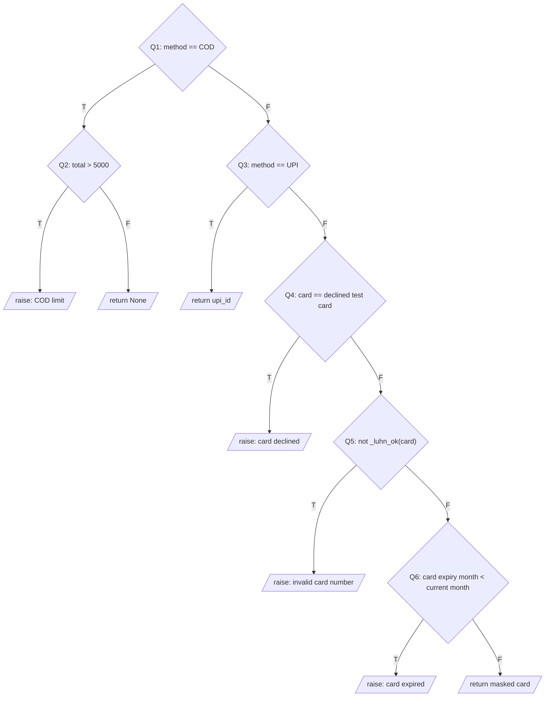

# CFG: `checkout_service._validate_payment` (R5.3)

Source: `00_Application/backend/app/services/checkout_service.py` lines 66-86.

N = 14 (6 predicates, 7 terminal nodes, 1 exit), E = 19, V(G) = 7.
