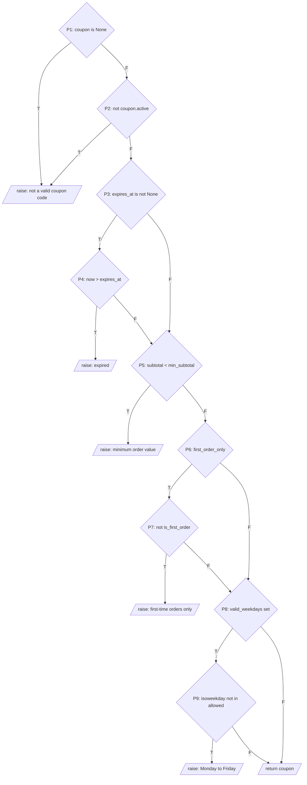

# CFG: `pricing_service.validate_coupon` (R4.1, R4.2)

Source: `0-application/backend/app/services/pricing_service.py` lines 22-36. One node per simple
condition (short-circuit `or`/`and` are split), so condition coverage can be read off the graph.

N = 16 (9 predicates, 5 raise nodes, 1 return, 1 exit), E = 24, V(G) = 10. See
[`../Basis_Path_Testing.md`](../Basis_Path_Testing.md).
