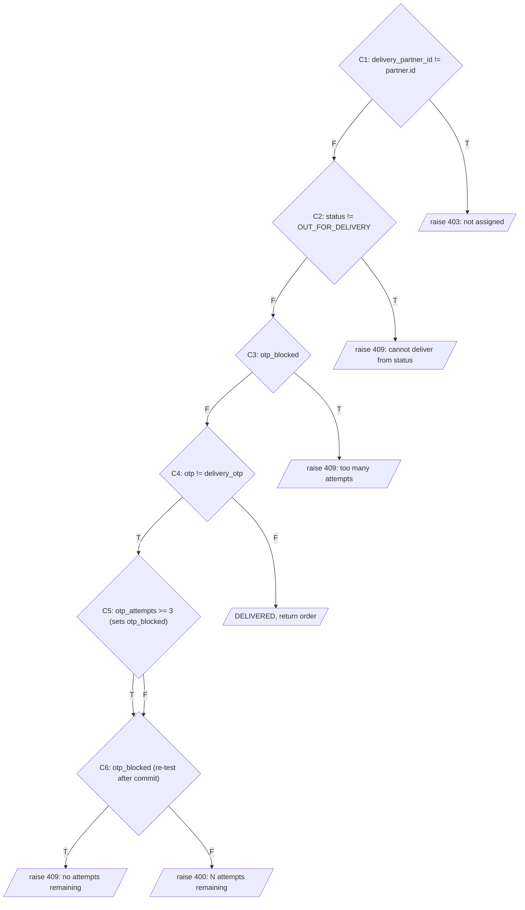

# CFG: `order_service.complete_delivery` (R6.4)

Source: `application/backend/app/services/order_service.py` lines 129-149 (the `_load_order`
call is ignored; its not-found branch is covered by the API suite).

N = 13 (6 predicates, 6 terminal nodes, 1 exit), E = 18, V(G) = 7. C6 is not independent of C5
(it can only be true if C5 was true, because C3 was false on entry), so one of the 7 basis paths
is infeasible; see [`../Basis_Path_Testing.md`](../Basis_Path_Testing.md).
