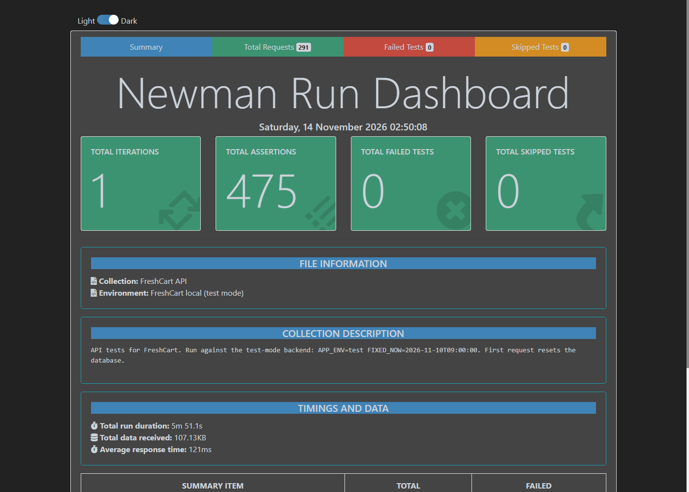

**Defect ID:** DEF-004
**Title:** `GET /api/checkout/slots` is reachable without authentication
**Reported by:** QA (API test suite, `7-api-testing`)
**Date found:** 2026-11-13
**Found via:** Newman request "[API-CHK] Slots without a token" (expected 401, got 200)
**Module:** M5 Checkout
**Rule ID(s) affected:** R1.6 (customer endpoints need a valid token), R5.2
**Severity:** Low (information disclosure: slot occupancy)
**Priority:** P3
**Environment:** `APP_ENV=test FIXED_NOW=2026-11-10T09:00:00`

## Summary

`REQUIREMENTS.md` lists `GET /checkout/slots` as `CUSTOMER` only. The route has no auth dependency, so an
anonymous caller receives every slot with its remaining capacity.

## Steps to reproduce

`curl -i http://localhost:8001/api/checkout/slots` with no `Authorization` header.

## Expected result

401 `{"status":401,"error":"UNAUTHORIZED",...}`.

## Actual result

200 with the slot list (`slot_start`, `slot_end`, `available`, `remaining_capacity`).

## Root cause

`routers/checkout.py::list_slots` declares `db` and `now` dependencies only. `place_order`, on the same
router, declares `require_customer`.

## Fix

Add `user=Depends(require_customer)` to `list_slots`. The only client is `/checkout` in the frontend, which is
behind `RoleGuard` for CUSTOMER and already sends the token. Verified by the Newman request above (401
without a token, 200 for a customer).

## Status

Fixed.

## Verification evidence

- Regression test: Newman request `[TC-M5-004] Available slots honour the 2-hour lead time` (401 without a token, 200 for a customer).
- Final run report: [`selenium_report.html`](../10-test-execution/selenium_report.html) (86 passed), [`newman_report.html`](../7-api-testing/reports/newman_report.html) (0 failed)
- Screenshot: 
