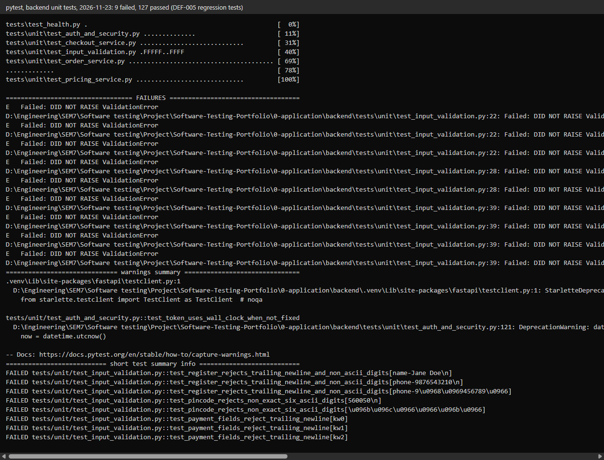

**Defect ID:** DEF-005
**Title:** Name, phone, pincode, UPI and card fields accept a trailing newline and non-ASCII digits
**Reported by:** QA (white-box review of `schemas/user.py`, confirmed through the API)
**Date found:** 2026-11-13
**Found via:** Reading the validation regexes while analysing R1.1/R1.4, then `POST /api/auth/register` with a
trailing newline
**Module:** M1 Registration, M5 Checkout
**Rule ID(s) affected:** R1.1 (letters and spaces only), R1.4 (exactly 10 digits), R5.1 (6-digit pincode), R5.3
**Severity:** Low
**Priority:** P3
**Environment:** Python 3.12, Pydantic 2.10

## Summary

The patterns end in `$`, which in Python also matches just before a final `\n`, and use `\d`, which matches
any Unicode decimal digit. A value that is not exactly N ASCII digits therefore passes.

## Steps to reproduce

```
curl -X POST http://localhost:8001/api/auth/register -H 'content-type: "application/json"' \
  --data-binary '{"name":"Jane Doe\n","email":"nl1@example.com","password":"Passw0rd1","phone":"9123456789\n"}'
```

## Expected result

422 with field errors on `name` and `phone`.

## Actual result

201. Response body: `"name":"Jane Doe\n"`, `"phone":"9123456789\n"` (an 11-character phone number stored).

## Root cause

`NAME_RE`, `PHONE_RE`, `EMAIL_RE`, `PINCODE_RE`, `UPI_RE`, `CARD_EXPIRY_RE` and two inline card/CVV patterns used
`^...$` without `\Z` and without `re.ASCII`.

## Fix

Proposed (and previously applied in `611d7f4`): anchor with `\Z` and compile with `re.ASCII` in `app/schemas/user.py` and `app/schemas/order.py`. Regression
tests: `tests/unit/test_input_validation.py` (12 cases; 9 fail on the old code, all pass after the fix).

## Status

Open. Reopened on 2026-11-23 for the demo: the fix commit (`611d7f4`) was backed out of the application code so the regression checks fail on purpose and the defect workflow can be shown. Re-applying that commit's code change closes it.

## Verification evidence

- Failing tests: `tests/unit/test_input_validation.py`, 9 of 12 cases fail (`DID NOT RAISE ValidationError`); log in [`unit_run_open_defects.txt`](../10-test-execution/unit_run_open_defects.txt).
- Failing Newman requests: the three `[DEF-005]` requests (name, phone and pincode with a trailing newline return 201/200 instead of 422).
- Knock-on effect: the pincode request with a trailing newline now places an order, which empties the cart that the later M5 and M6 requests use, so 11 further requests fail (card checks, UPI checkout, stock, cancellation).
- Screenshot: 
