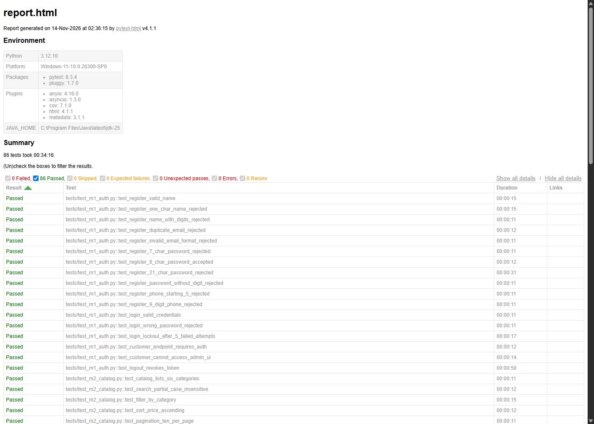

**Defect ID:** DEF-007
**Title:** Catalog search can show the results of an earlier keystroke instead of the final search term
**Reported by:** QA (Selenium full run, intermittent failure of `test_inactive_product_hidden_from_customers`)
**Date found:** 2026-11-14
**Found via:** The failure was not reproducible by re-running the test, so `diagnostics/diag_search_stale_response.py`
was written to type a search term quickly and inspect the final DOM and the request timings
**Module:** M2 Catalog (frontend)
**Rule ID(s) affected:** R2.3 (search), R2.4 (inactive products hidden)
**Severity:** Medium (wrong results shown, no error)
**Priority:** P2
**Environment:** Next.js production build, headless Chrome 157, local backend

## Summary

`app/page.tsx` calls `GET /catalog/products?search=...` on every keystroke and stores whichever response arrives
last. Responses for `A`, `Ap`, `App`, `Appl`, `Apple` complete in arbitrary order, so the list can end up showing
the result of a shorter prefix while the box says `Apple`.

## Steps to reproduce

1. Deactivate Apple (`PATCH /admin/products/{id}/active`).
2. Open `/`, type `Apple` quickly into the search box, wait 3 seconds.

Script: `python diagnostics/diag_search_stale_response.py 40`.

## Expected result

Empty state ("No products found") for `Apple`.

## Actual result

Before the fix, 37 of 40 loads ended with a non-empty list. A trace of one load: the input read `Apple`, the
page showed `Grapes` (the result for `Ap`), and the five requests completed in the order
`App`, `Appl`, `A`/`Ap`/`Apple` (all about 1049 ms) rather than the order they were sent.

## Root cause

`loadProducts` has no guard against out-of-order responses (no debounce, no abort, no request id).

## Fix

A `useRef` counter: each call takes an id, and only the call whose id is still the latest may update `products`,
`totalPages`, `error` or `loading`. After the fix the same script reports 0 of 40 stale loads.

## Status

Fixed.

## Verification evidence

- Regression test: Selenium `test_m2_catalog.py::test_inactive_product_hidden_from_customers`, passing in the final run.
- Final run report: [`selenium_report.html`](../10-test-execution/selenium_report.html) (86 passed), [`newman_report.html`](../7-api-testing/reports/newman_report.html) (the 2026-11-23 run has 23 failed assertions, all from the reopened DEF-004 and DEF-005, none from this defect)
- Screenshot: 
