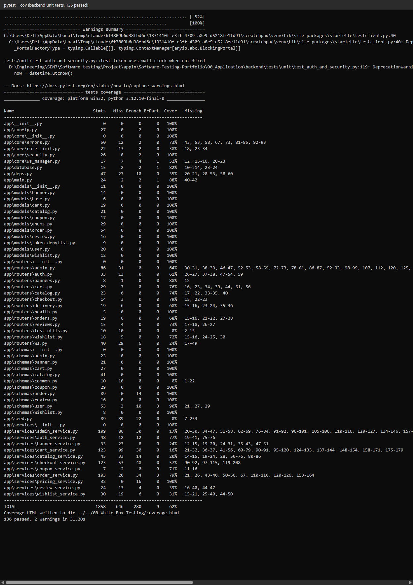

**Defect ID:** DEF-003
**Title:** In test mode, JWTs are rejected once real time passes `FIXED_NOW` + 30 minutes
**Reported by:** QA (portfolio re-verification run)
**Date found:** 2026-11-13
**Found via:** Re-running the Selenium suite (`test_checkout_serviceable_pincode_succeeds`) and a diagnostic script
**Module:** M1 Auth (affects every authenticated flow in `APP_ENV=test`)
**Rule ID(s) affected:** R1.5 (token with 30 min expiry), R1.6 (401 only for invalid/expired token)
**Severity:** High (blocks all authenticated automated tests; no impact on production clock)
**Priority:** P1
**Environment:** `APP_ENV=test FIXED_NOW=2026-11-10T09:00:00`, real date 2026-11-13, Python 3.12, python-jose 3.3.0

## Summary

`create_access_token` computes `exp` from the injected clock (`FIXED_NOW + 30 min` =
2026-11-10T09:30Z). `decode_access_token` used `jose.jwt.decode`, which compares `exp` with the
real wall clock. After 2026-11-10T09:30Z real time, every token issued in test mode is already
expired when it is created.

## Steps to reproduce

1. Start the backend with `APP_ENV=test FIXED_NOW=2026-11-10T09:00:00` on a date after 2026-11-10.
2. `POST /api/test/reset`, then log in as `customer2@freshcart.test`.
3. `GET /api/auth/me` with the returned token.

## Expected result

200 with the user.

## Actual result

401 `{"status":401,"error":"UNAUTHORIZED","message":"Invalid or expired token."}`.
In the UI the frontend injects the token, `/auth/me` returns 401, `AuthProvider` clears it and
`RoleGuard` redirects to `/login`. `automation-testing/selenium-or-playwright/diagnostics/diag_checkout_selenium.py`
shows the redirect: `/checkout` renders, then the URL becomes `/login` one second later, and
the browser console lists `GET /api/auth/me 401`.

## Evidence

- Diagnostic output (2026-11-13): `get /checkout` then `url=http://localhost:3000/login`.
- `curl` login followed by `/auth/me`: 401 before the fix, 200 after.

## Root cause

Two clocks. Issue time and business rules use `get_now()` (injected); token expiry validation used
the real clock. This is also the likely reason the original run of the suite was time-sensitive:
it could only pass while real time was before `FIXED_NOW + 30 min`.

The earlier explanation recorded in `Execution_Log.md` (Selenium or chromedriver timeouts) is
not supported by this evidence for the login-dependent tests. Whether it explains those 6
original failures specifically is re-checked in
[`../test-execution/Execution_Log.md`](../test-execution/Execution_Log.md).

## Fix

`app/core/security.py`: `decode_access_token` disables jose's `exp` check and compares `exp` with
the same injected clock (`settings.fixed_now`, else the wall clock). Commit `4d80c7b`. Unit tests
`tests/unit/test_security.py` cover both clocks.

## Status

Fixed and verified (see Execution Log).

## Verification evidence

- Regression test: Selenium `test_checkout_serviceable_pincode_succeeds`, plus the unit tests named in the Fix section.
- Final run report: [`selenium_report.html`](../test-execution/selenium_report.html) (86 passed), [`newman_report.html`](../api-testing/reports/newman_report.html) (0 failed)
- Screenshot: 
