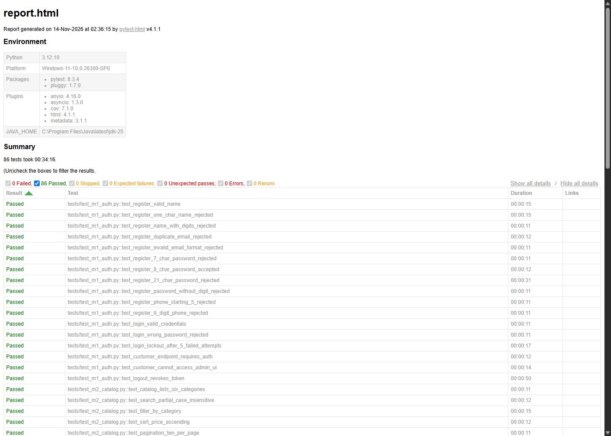

**Defect ID:** DEF-006
**Title:** Clicking a wishlist heart before the session is restored redirects a logged-in user to /login
**Reported by:** QA (Selenium re-run, `test_add_product_to_wishlist`)
**Date found:** 2026-11-14
**Found via:** Code reading while investigating the intermittent failure of `test_add_product_to_wishlist`. The
failure itself was later traced mainly to DEF-008; this race is a separate defect in the same page and was not
independently reproduced (see Notes).
**Module:** M9 Wishlist (frontend, catalog page)
**Rule ID(s) affected:** R9.1
**Severity:** Low (window of a few hundred milliseconds after page load)
**Priority:** P3
**Environment:** Next.js production build, headless Chrome 157

## Summary

On `/`, the product grid and heart buttons render as soon as products load. The session is restored
asynchronously (`GET /auth/me`), and until it returns `useAuth().user` is `null`. `toggleWishlist` treats
`!user` as "guest" and calls `router.push("/login")`. A logged-in user who clicks a heart in that window is sent
to the login page and the item is not saved.

## Steps to reproduce

1. Log in, then reload `/` (token in `localStorage`).
2. Click a heart as soon as the grid appears, before `GET /api/auth/me` completes.

## Expected result

The item is added (or the click is ignored until the session is known).

## Actual result

By code inspection: redirect to `/login`, nothing added. Not captured as a failing run on its own: in
`diagnostics/diag_wishlist_race.py` the item was saved in 7 of 8 iterations without waiting and 8 of 8 when
waiting for the heart to fill, but that script cannot tell this race from DEF-008.

## Root cause

`app/page.tsx` reads only `user` from `useAuth()` and ignores `loading`.

## Fix

Read `loading` as `authLoading` and add it to the button's `disabled` condition. The test now waits for the
logged-in navbar (`nav-logout-button`) before clicking, and for the heart to fill before navigating away.

## Notes

Severity and priority are low because the window is a few hundred milliseconds and the effect is a redirect, not data
loss. The fix is defensive and verified only by the full suite passing.

## Status

Fixed (not independently reproduced before the fix).

## Verification evidence

- Regression test: Selenium `test_m9_wishlist_banners_offers.py::test_add_product_to_wishlist`, passing in the final run.
- Final run report: [`selenium_report.html`](../test-execution/selenium_report.html) (86 passed), [`newman_report.html`](../api-testing/reports/newman_report.html) (0 failed)
- Screenshot: 
