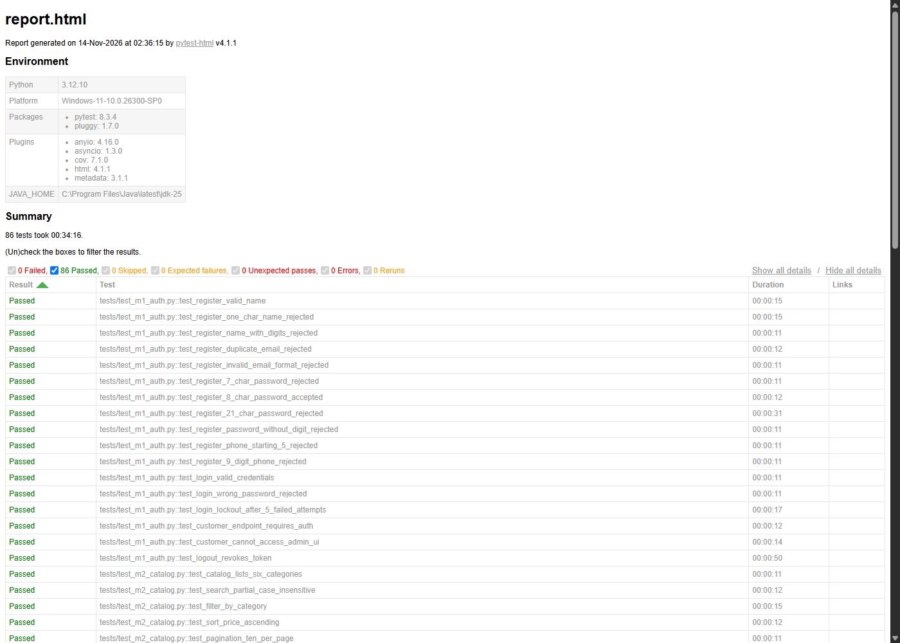

**Defect ID:** DEF-002
**Title:** `GET /admin/orders` crashes with a 500 error (MissingGreenlet) once any order exists
**Reported by:** Developer (caught via a Playwright-driven UI check during frontend
integration, before the Selenium suite existed)
**Date found:** 2026-11-09
**Found via:** Manual/scripted browser verification of the admin order-management flow
**Module:** M8 — Admin (order list), M6 — Orders
**Rule ID(s) affected:** R8.2
**Severity:** Critical
**Priority:** P1
**Environment:** `APP_ENV=test`, SQLite, backend commit at the time of M8 development

## Summary

The admin order list endpoint (and therefore the `/admin/orders` page) threw an unhandled
500 error as soon as at least one order existed in the database, making the entire admin
order-management screen unusable.

## Steps to reproduce

1. Place at least one order as a customer.
2. Log in as admin.
3. `GET /api/admin/orders` (or open `/admin/orders` in the browser).

## Expected result

200 response with the list of orders (as every other order-listing endpoint in the app
already returned correctly, e.g. the customer's own `/orders`).

## Actual result

500 Internal Server Error. Backend log:

```
sqlalchemy.exc.MissingGreenlet: greenlet_spawn has not been called; can't call await_only()
here. Was IO attempted in an unexpected place?
```

raised from inside `order_service.to_order_dict()` at `item.product.unit`.

## Root cause

`admin_service.list_orders()` eager-loaded `Order.items` via `selectinload(Order.items)` but
not the *nested* `OrderItem.product` relationship. When `to_order_dict()` later accessed
`item.product.unit` for each line item, SQLAlchemy tried to lazily load `product` — which
requires an actual DB round-trip — but async SQLAlchemy cannot perform an implicit lazy load
outside of the greenlet context that `async`/`await` machinery sets up, so it raised
`MissingGreenlet` instead of silently (and dangerously) blocking.

Every *other* place in the codebase that builds an order response already used the correct
nested eager-load (`selectinload(Order.items).selectinload(OrderItem.product)`) — this was the
one query that was missed when `admin_service.py` was written.

## Fix

Changed the query in `admin_service.list_orders()` to
`selectinload(Order.items).selectinload(OrderItem.product)`, matching every other order query
in the codebase.

**File changed:** `Application/backend/app/services/admin_service.py`

## Status

Fixed and verified — re-tested via a full admin order-lifecycle run (confirm → pack → assign
→ dispatch → deliver) with orders present, admin order list loads correctly throughout. See
commit `29b60e1` ("style+feat(frontend): QuickCart-inspired redesign, wishlist, banners,
offers" — the fix landed alongside the frontend work that surfaced it).

## Verification evidence

- Regression test: Selenium `test_m6_order_lifecycle.py` and `test_m8_admin.py::test_admin_filters_orders_by_status` list orders as admin and pass.
- Final run report: [`selenium_report.html`](../Test_Execution/selenium_report.html) (86 passed), [`newman_report.html`](../API_Testing/reports/newman_report.html) (0 failed)
- Screenshot: 
