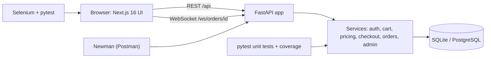

# Software Testing Portfolio - FreshCart

[](https://github.com/praarn/Software-Testing-Portfolio-7thSem/actions/workflows/ci.yml)

Online portfolio for the Software Testing course. The application under test is **FreshCart**, an online grocery shopping
and delivery system (FastAPI backend, Next.js frontend). Around it sits the testing work: plan, requirements analysis,
black-box and white-box design, API and UI automation, execution results, defects, reports and a demo.

## Student details

| | |
|---|---|
| Subject / course code / semester | TODO: subject name, course code, semester |
| Faculty | TODO: faculty name |
| Demo | TODO: date and format; video link (upload outside the repository and paste it here) - script in [`10_Demo/Demo_Script.md`](10_Demo/Demo_Script.md) |

| Member | Roll number | Role |
|---|---|---|
| TODO: name | TODO | Test Analyst |
| TODO: name | TODO | Test Engineer |
| TODO: name | TODO | Automation and QA Engineer |

Contributions and reflections: [`Team_Learning_Reflection.md`](Team_Learning_Reflection.md).

## Objectives

1. Analyse the requirements of a real application and plan its testing.
2. Design test cases with equivalence partitioning, boundary value analysis, decision tables and state transition testing.
3. Apply white-box techniques: control flow graphs, basis path testing, statement, branch and condition coverage.
4. Test the REST API (Postman/Newman) and the UI (Selenium) and run both in CI.
5. Execute, record actual results, report defects and give a final test report.

## The application

FreshCart has three roles: customer, admin and delivery partner. Customers browse and search a catalog, keep a cart and
wishlist, apply coupons, check out with a delivery slot and COD, UPI or card payment, and follow the order live over a
WebSocket. Admins manage products, orders, coupons, users, banners and read the audit log. Delivery partners dispatch
orders and confirm delivery with the customer's OTP. 42 business rules (R1.1-R9.3) are listed in
[`00_Application/docs/REQUIREMENTS.md`](00_Application/docs/REQUIREMENTS.md).



## At a glance

| | |
|---|---|
| Business rules | 42, all traced to test cases |
| Test cases designed | 116 (86 Selenium, 22 API, 8 unit) |
| Selenium suite | 86 passed, 0 failed |
| API suite (Newman) | 245 requests, 475 assertions, 0 failed |
| Unit tests | 136 passed; 65.2% statement and 38.2% branch coverage alone, 95.0% and 86.8% combined with the API suite |
| Defects | 8 found (DEF-001 to DEF-008), 0 open |
| CI | GitHub Actions: backend with coverage, Newman, frontend build, Selenium; all four jobs green on a hosted runner (2026-11-14) |

## Test evidence

Every number above comes from a saved tool report, not from the Markdown. Open the report to check it.

| Test type | Result | Open the report | Screenshot |
|---|---|---|---|
| Selenium UI (pytest) | 86 passed, 0 failed | [`selenium_report.html`](03_Test_Execution/selenium_report.html), [`selenium_junit.xml`](03_Test_Execution/selenium_junit.xml) | [`13`](07_Screenshots/13_pytest_html_report.png), [`11`](07_Screenshots/11_pytest_selenium_run.png) |
| API (Newman) | 245 requests, 475 assertions, 0 failed | [`newman_report.html`](09_API_Testing/reports/newman_report.html), [`newman_report.json`](09_API_Testing/reports/newman_report.json) | [`16`](07_Screenshots/16_newman_html_report.png), [`15`](07_Screenshots/15_newman_cli_summary.png) |
| Unit and coverage (pytest-cov) | 136 passed | [`coverage_html/index.html`](08_White_Box_Testing/coverage_html/index.html), [`Coverage_Report.md`](08_White_Box_Testing/Coverage_Report.md) | [`14`](07_Screenshots/14_coverage_html_report.png), [`12`](07_Screenshots/12_pytest_cov_unit_run.png) |
| CI (GitHub Actions) | 4 of 4 jobs green | [Actions tab](https://github.com/praarn/Software-Testing-Portfolio-7thSem/actions), reports kept as run artifacts | badge above |
| Defects | 8 found, 0 open | [`04_Defect_Reports/`](04_Defect_Reports/), each with its regression test and screenshot | |

HTML reports show as source code on GitHub. Download the file and open it in a browser, or use the screenshots.


Printable summary: [`06_Test_Reports/Test_Summary_Report.pdf`](06_Test_Reports/Test_Summary_Report.pdf).
Walkthrough of the reports as a GIF: [`10_Demo/test_evidence_walkthrough.gif`](10_Demo/test_evidence_walkthrough.gif).

## Assignment requirement to folder

| Requirement | Where |
|---|---|
| README: student details, subject, objectives, project description | this file |
| Introduction to the application | this file, [`00_Application/`](00_Application/) |
| Requirements analysis | [`01_Test_Plan/Requirements_Analysis.md`](01_Test_Plan/Requirements_Analysis.md) |
| Test plan | [`01_Test_Plan/Test_Plan.md`](01_Test_Plan/Test_Plan.md) |
| Test scenarios and cases (`.xlsx`) | [`02_Test_Case_Design/Functional_Test_Cases.xlsx`](02_Test_Case_Design/Functional_Test_Cases.xlsx), `Test_Cases.csv`, `Traceability_Matrix.md` |
| Equivalence partitioning, BVA, decision table, state transition | [`02_Test_Case_Design/`](02_Test_Case_Design/) (one document each) |
| White-box: CFG, basis path, statement/branch/condition coverage, coverage report | [`08_White_Box_Testing/`](08_White_Box_Testing/) |
| API testing | [`09_API_Testing/`](09_API_Testing/) |
| Automation testing (Selenium; additional activity) | [`05_Test_Automation/`](05_Test_Automation/) |
| Test execution with actual results | [`03_Test_Execution/`](03_Test_Execution/) |
| Defect and bug reports | [`04_Defect_Reports/`](04_Defect_Reports/) |
| Execution summary and final test report | [`06_Test_Reports/Test_Summary_Report.md`](06_Test_Reports/Test_Summary_Report.md), [`Conclusion.md`](Conclusion.md) |
| Screenshots, diagrams, scripts, video evidence | [`07_Screenshots/`](07_Screenshots/), Mermaid diagrams in this file, `02_Test_Case_Design/State_Transition.md` and `08_White_Box_Testing/Control_Flow_Graphs/`, scripts in `05_Test_Automation/` and `tools/` |
| Short demo video, demonstration and viva | [`10_Demo/`](10_Demo/) (script, viva Q&A, checklist; video link above is a TODO) |
| Individual contribution and reflection, GitHub activity | [`Team_Learning_Reflection.md`](Team_Learning_Reflection.md) |
| CI | [`.github/workflows/ci.yml`](.github/workflows/ci.yml) |

## Repository layout

| Folder / file | Contents |
|---|---|
| [`00_Application/`](00_Application/) | FreshCart: `backend/` (FastAPI, with `tests/unit/`), `frontend/` (Next.js), `docs/REQUIREMENTS.md` |
| [`01_Test_Plan/`](01_Test_Plan/) | Test plan, requirements analysis |
| [`02_Test_Case_Design/`](02_Test_Case_Design/) | Cases (CSV, xlsx), traceability matrix, EP, BVA, decision table, state transition |
| [`03_Test_Execution/`](03_Test_Execution/) | Execution log, per-case results, formerly manual cases |
| [`04_Defect_Reports/`](04_Defect_Reports/) | DEF-001 to DEF-008 and a template |
| [`05_Test_Automation/`](05_Test_Automation/) | Selenium + pytest suite, `diagnostics/`, `tools/` |
| [`06_Test_Reports/`](06_Test_Reports/) | Test summary report |
| [`07_Screenshots/`](07_Screenshots/) | Application and test-run screenshots |
| [`08_White_Box_Testing/`](08_White_Box_Testing/) | CFGs, basis path testing, coverage report and HTML |
| [`09_API_Testing/`](09_API_Testing/) | Postman collection, Newman reports, results |
| [`10_Demo/`](10_Demo/) | Demo script, viva Q&A, pre-demo checklist |
| `tools/` | `consistency_check.py`, coverage and screenshot helpers |
| `Conclusion.md`, `Team_Learning_Reflection.md` | Results and lessons; contributions and reflections |
| `docker-compose.yml`, `commands.md`, `explanation.md` | Docker stack, run commands per OS, repo map |

## Quick start

Local, with SQLite (two terminals):

```bash
# Terminal 1: backend
cd 00_Application/backend
pip install -r requirements.txt
alembic upgrade head
python -m app.seed
uvicorn app.main:app --reload      # http://localhost:8000  (Swagger UI at /docs)

# Terminal 2: frontend
cd 00_Application/frontend
npm install
npm run dev                        # http://localhost:3000
```

Or `docker compose up --build` (PostgreSQL included). Prerequisites: Python 3.12, Node 20 or newer, Chrome for Selenium.
Per-OS commands, including PowerShell, are in [`commands.md`](commands.md).

## Running the tests

```bash
# Backend in test mode (resettable database, frozen clock)
cd 00_Application/backend
APP_ENV=test FIXED_NOW=2026-11-10T09:00:00 uvicorn app.main:app --port 8000

# Unit tests with coverage (no server needed)
pytest --cov=app --cov-branch --cov-report=term-missing

# Selenium (use a production build of the frontend: npm run build && npm start)
cd 05_Test_Automation && pip install -r requirements.txt && pytest

# API (about 6 minutes: the login rate limit is paced on purpose)
cd 09_API_Testing && npx newman run FreshCart.postman_collection.json -e FreshCart.postman_environment.json

# Check that every count quoted in the docs matches the tools' output
python tools/consistency_check.py
```

## Seed accounts

| Role | Email | Password |
|---|---|---|
| Admin | admin@freshcart.test | Admin@1234 |
| Delivery partner | driver1@freshcart.test | Driver@1234 |
| Customer (has an order) | customer1@freshcart.test | Customer@1234 |
| Customer (no orders, eligible for `WELCOME10`) | customer2@freshcart.test | Customer@1234 |

More accounts, coupons and test-mode variables: [`00_Application/README.md`](00_Application/README.md).
