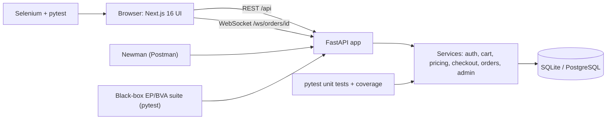
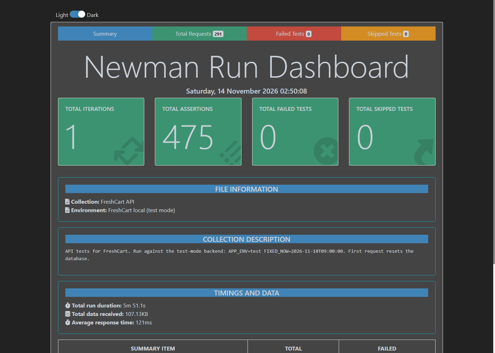
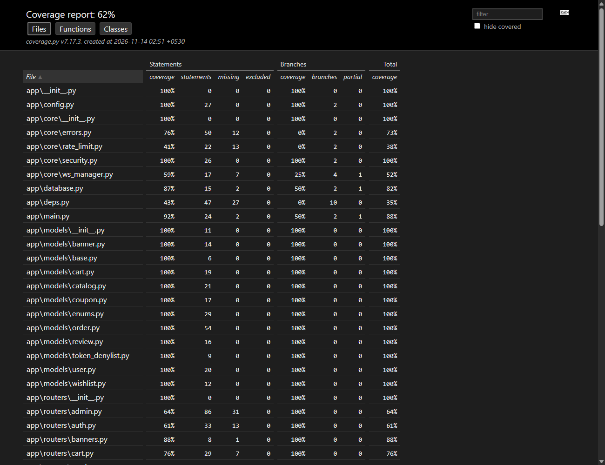

# Software Testing Portfolio - FreshCart

[](https://github.com/praarn/Software-Testing-Portfolio-7thSem/actions/workflows/ci.yml)

Online portfolio for the Software Testing course. The application under test is **FreshCart**, an online grocery shopping
and delivery system (FastAPI backend, Next.js frontend). Around it sits the testing work: plan, requirements analysis,
black-box and white-box design, API and UI automation, execution results, defects, reports and a demo.

## Student details

| | |
|---|---|
| Subject / course code / semester | TODO: subject name, course code, semester |
| Faculty | TODO: faculty name |
| Demo | TODO: date and format; video link (upload outside the repository and paste it here) |

| Member | Roll number | Role |
|---|---|---|
| Prapti R. N. | 1MS23IS094 | Test Analyst |
| Poorvika G. J. | 1MS23IS090 | Test Engineer |

Contributors: [@praarn](https://github.com/praarn) and [@poorvikagj](https://github.com/poorvikagj).

Contributions and reflections: [`reflections/Team_Learning_Reflection.md`](reflections/Team_Learning_Reflection.md).

## Objectives

1. Analyse the requirements of a real application and plan its testing.
2. Black-box testing with two methods, equivalence partitioning and boundary value analysis, designed (with decision
   tables and state transition testing as support) and executed as a data-driven suite over HTTP.
3. White-box testing with two methods: basis path testing (control flow graphs, V(G), one test per path) and
   statement, branch and condition coverage.
4. Test the REST API (Postman/Newman) and the UI (Selenium) and run all suites in CI.
5. Execute, record actual results, report defects and give a final test report.

## The application

FreshCart has three roles: customer, admin and delivery partner. Customers browse and search a catalog, keep a cart and
wishlist, apply coupons, check out with a delivery slot and COD, UPI or card payment, and follow the order live over a
WebSocket. Admins manage products, orders, coupons, users, banners and read the audit log. Delivery partners dispatch
orders and confirm delivery with the customer's OTP. 42 business rules (R1.1-R9.3) are listed in
[`application/docs/REQUIREMENTS.md`](application/docs/REQUIREMENTS.md).



## At a glance

| | |
|---|---|
| Business rules | 42, all traced to test cases |
| Test cases designed | 169 (86 Selenium, 22 API, 45 black-box EP/BVA, 16 unit) |
| Black-box suite (EP and BVA) | 288 passed, 0 failed |
| Selenium suite | 86 passed, 0 failed |
| API suite (Newman) | 245 requests, 475 assertions, 0 failed |
| Unit tests | 136 passed; 65.2% statement and 38.2% branch coverage alone, 95.0% and 86.8% combined with the API suite |
| Defects | 8 found (DEF-001 to DEF-008), 0 open |
| CI | GitHub Actions: backend with coverage, Newman, frontend build, Selenium and the black-box suite (all five jobs green on a hosted runner, 2026-11-19) |

## Test evidence

Every number above comes from a saved tool report, not from the Markdown. Open the report to check it.

| Test type | Result | Open the report | Screenshot |
|---|---|---|---|
| Selenium UI (pytest) | 86 passed, 0 failed | [`selenium_report.html`](test-execution/selenium_report.html), [`selenium_junit.xml`](test-execution/selenium_junit.xml) | [`13`](evidence/screenshots/13_pytest_html_report.png), [`11`](evidence/screenshots/11_pytest_selenium_run.png) |
| Black-box EP and BVA (pytest) | 288 passed, 0 failed | [`Black_Box_Results.md`](black-box-testing/Black_Box_Results.md), [`black_box_junit.xml`](black-box-testing/results/black_box_junit.xml) | |
| API (Newman) | 245 requests, 475 assertions, 0 failed | [`newman_report.html`](api-testing/reports/newman_report.html), [`newman_report.json`](api-testing/reports/newman_report.json) | [`16`](evidence/screenshots/16_newman_html_report.png), [`15`](evidence/screenshots/15_newman_cli_summary.png) |
| Unit and coverage (pytest-cov) | 136 passed | [`coverage_html/index.html`](white-box-testing/coverage_html/index.html), [`Coverage_Report.md`](white-box-testing/Coverage_Report.md) | [`14`](evidence/screenshots/14_coverage_html_report.png), [`12`](evidence/screenshots/12_pytest_cov_unit_run.png) |
| CI (GitHub Actions) | 5 of 5 jobs green on 2026-11-19 (run 44557615256) | [Actions tab](https://github.com/praarn/Software-Testing-Portfolio-7thSem/actions), reports kept as run artifacts | badge above |
| Defects | 8 found, 0 open | [`defect-reports/`](defect-reports/), each with its regression test and screenshot | |

HTML reports show as source code on GitHub. Download the file and open it in a browser, or use the screenshots.






Printable summary: [`final-test-report/Test_Summary_Report.pdf`](final-test-report/Test_Summary_Report.pdf).
Screenshots of every testing activity and metric charts: [`evidence/screenshots/`](evidence/screenshots/), figures in [`final-test-report/Test_Metrics.md`](final-test-report/Test_Metrics.md).
Walkthrough of the reports as a GIF: [`evidence/videos/test_evidence_walkthrough.gif`](evidence/videos/test_evidence_walkthrough.gif).

## Portfolio contents

| # | Section | Folder / file |
|---|---|---|
| 1 | Introduction to the application | [`introduction/`](introduction/Application_Introduction.md), source in [`application/`](application/) |
| 2 | Requirements analysis | [`requirements/`](requirements/Requirements_Analysis.md) |
| 3 | Test plan | [`test-plan/`](test-plan/Test_Plan.md) |
| 4 | Test scenarios and test cases | [`test-cases/`](test-cases/): `Functional_Test_Cases.xlsx`, `Test_Cases.csv`, `Traceability_Matrix.md` |
| 5 | Black-box testing: equivalence partitioning, boundary value analysis, decision table, state transition | [`black-box-testing/`](black-box-testing/): one design document per technique, plus the executable suite and results |
| 6 | White-box testing: control flow graphs, basis path testing, statement/branch/condition coverage | [`white-box-testing/`](white-box-testing/) |
| 7 | API testing | [`api-testing/`](api-testing/): Postman collection, Newman reports, results |
| 8 | Automation testing | [`automation-testing/selenium-or-playwright/`](automation-testing/selenium-or-playwright/): Selenium + pytest suite |
| 9 | Defect / bug reports | [`defect-reports/`](defect-reports/): DEF-001 to DEF-008 and a template |
| 10 | Test execution results | [`test-execution/`](test-execution/) |
| 11 | Screenshots and video evidence | [`evidence/`](evidence/): `screenshots/`, `videos/` |
| 12 | Final test report | [`final-test-report/`](final-test-report/): summary report, metrics, conclusion |
| 13 | Individual contribution and reflection | [`reflections/Team_Learning_Reflection.md`](reflections/Team_Learning_Reflection.md) |

Supporting files: [`tools/`](tools/) (consistency check, coverage and screenshot helpers), `docker-compose.yml`,
`commands.md` (run commands per OS), `explanation.md` (repository map), CI in
[`.github/workflows/ci.yml`](.github/workflows/ci.yml). A short demo video link is still a TODO above; demo material is
kept outside the repository.

## Quick start

Local, with SQLite (two terminals):

```bash
# Terminal 1: backend
cd application/backend
pip install -r requirements.txt
alembic upgrade head
python -m app.seed
uvicorn app.main:app --reload      # http://localhost:8000  (Swagger UI at /docs)

# Terminal 2: frontend
cd application/frontend
npm install
npm run dev                        # http://localhost:3000
```

Or `docker compose up --build` (PostgreSQL included). Prerequisites: Python 3.12, Node 20 or newer, Chrome for Selenium.
Per-OS commands, including PowerShell, are in [`commands.md`](commands.md).

## Running the tests

```bash
# Backend in test mode (resettable database, frozen clock)
cd application/backend
APP_ENV=test FIXED_NOW=2026-11-10T09:00:00 uvicorn app.main:app --port 8000

# Unit tests with coverage (no server needed): white-box basis path and coverage cases
pytest --cov=app --cov-branch --cov-report=term-missing

# Black-box suite, equivalence partitioning and boundary value analysis (backend in test mode, about 3 minutes)
cd ../../black-box-testing && pip install -r requirements.txt && pytest
cd ../application/backend

# Selenium (use a production build of the frontend: npm run build && npm start)
cd automation-testing/selenium-or-playwright && pip install -r requirements.txt && pytest

# API (about 6 minutes: the login rate limit is paced on purpose)
cd api-testing && npx newman run FreshCart.postman_collection.json -e FreshCart.postman_environment.json

# Check that every count quoted in the docs matches the tools' output
python tools/consistency_check.py
```

## Seed accounts

| Role | Email | Password |
|---|---|---|
| Admin | admin@freshcart.test | Admin@1234 |
| Delivery partner | driver1@freshcart.test | Driver@1234 |
| Customer (has an order) | customer1@freshcart.test | Customer@1234 |
| Customer (no orders, eligible for `WELCOME10`) | customer2@freshcart.test | Customer@1234 |

More accounts, coupons and test-mode variables: [`application/README.md`](application/README.md).
